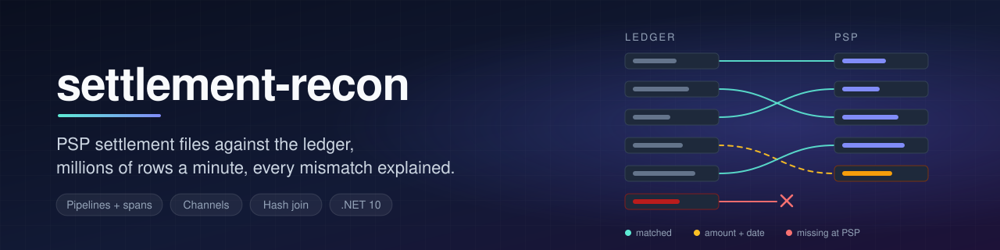
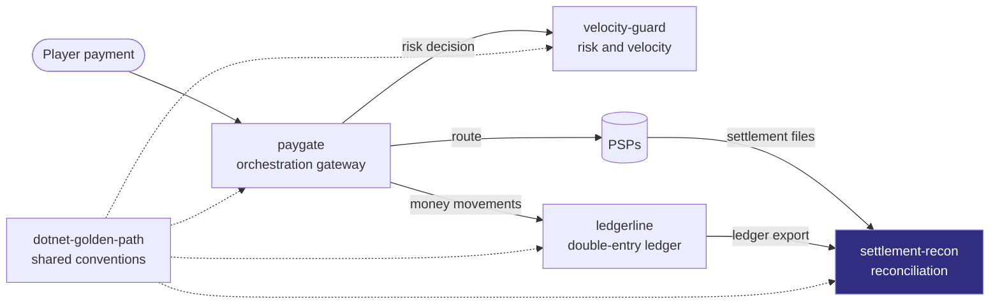
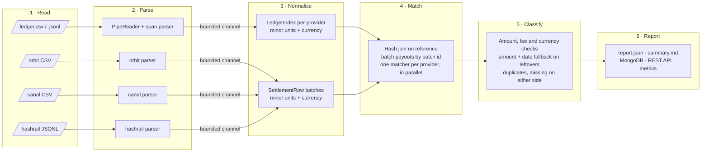
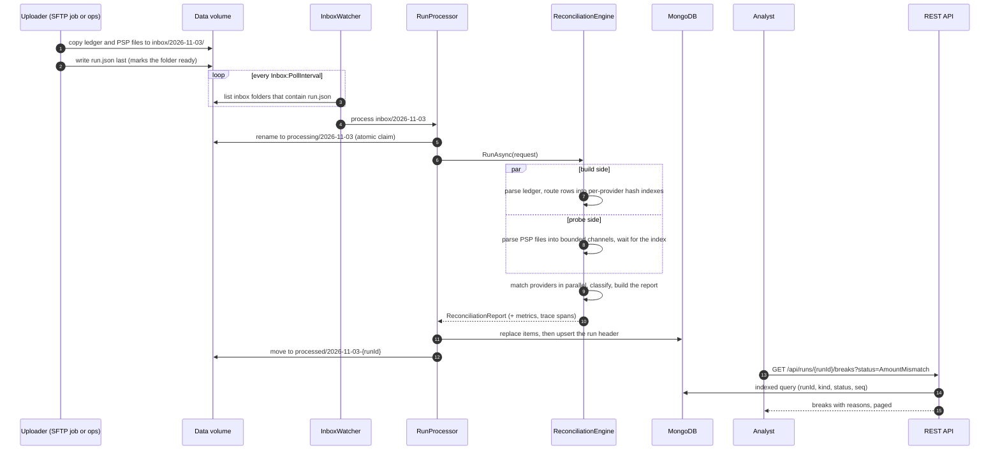

<div align="center">



# 🧾 settlement-recon

**Reconciles PSP settlement files against the internal ledger at millions of rows per minute, and explains every mismatch.**

Built with **.NET 10**, `System.IO.Pipelines`, `System.Threading.Channels` and **MongoDB**.

[](https://github.com/AutumnTrace/settlement-recon/actions/workflows/ci.yml)
[](https://github.com/AutumnTrace/settlement-recon/actions/workflows/codeql.yml)
[](https://github.com/AutumnTrace/settlement-recon/releases)


[](LICENSE)

[Quick start](#-quick-start) · [How it works](#-how-it-works) · [Example output](#-example-output) · [REST API](#-rest-api) · [Performance](#-performance) · [Design decisions](#-design-decisions) · [Changelog](CHANGELOG.md)

</div>

## 💡 Why this exists

Every payment provider (PSP) sends a settlement report: what it collected, what it charged and what it will pay out. Finance has to prove that each line matches a transaction the platform actually booked, and catch the ones that don't: a payout batch that is short by a few euros, a fee above the contract, a deposit settled twice, a refund the ledger never saw. Each provider writes its report differently, the files run to millions of lines, and the usual result is a spreadsheet and a lot of manual checking. This engine streams the files against the ledger in well under a second per million transactions on a desktop CPU, and gives every break a reason a person can act on without opening the files.

## ✨ Features

| | |
|---|---|
| ⚡ **Streaming parsers** | `PipeReader` + `ReadOnlySpan<byte>` parsing straight into integer minor units: no `string.Split`, no `decimal` and no per-row allocations on the hot path |
| 🧵 **Channel pipeline** | Bounded channels with backpressure between parse, index and match stages; settlement files parse while the ledger index builds, and providers match in parallel |
| 🗂️ **Hash join, bounded memory** | Open-addressing index (XxHash3) over struct chunks and a UTF-8 arena; settlement files of any size add only a few pooled batches |
| 🧾 **Explainable breaks** | 7 outcomes and 4 pairing rules, each break with a full-sentence reason, both amounts, the difference and line numbers on both sides |
| 🔁 **One-to-many and fuzzy matching** | Payout batches matched against the sum of their ledger entries; references mangled by bank rails paired by amount and date, and only when exactly one candidate qualifies |
| 🔌 **Pluggable formats** | Three simulated PSPs with deliberately different formats behind `ISettlementFormat`: comma CSV with gross/fee/net, semicolon CSV with comma decimals, crypto JSON Lines |
| 🎲 **Deterministic sample data** | Seeded generator with injected breaks and an `expected.json` that the tests compare against, byte-identical on every machine |
| 🖥️ **CLI** | `recon run` writes a JSON report and a Markdown summary; `recon generate`; `--fail-on-breaks` for schedulers |
| 📥 **Inbox worker** | Hosted service: atomic claim of dropped run folders, archive or `failed/` with `error.txt`, re-queue after a crash |
| 🍃 **MongoDB + REST API** | Runs and breaks stored as documents, paged and filtered through indexes; RFC 9457 problem details; in-memory fallback for local runs |
| 📈 **Observability** | Serilog, OpenTelemetry metrics (rows, breaks by type, run duration, throughput) and traces, OTLP or Azure Monitor, health probes |
| 🧪 **Tested** | 208 NUnit tests plus 7 Testcontainers MongoDB tests, property-based amount parsing, a differential test against the naive baseline |
| 🐳 **Ship-ready** | Chiseled non-root image, `docker compose` with MongoDB, GHCR releases, CodeQL, Dependabot |

## 🧩 Part of Payments Lab

Five .NET 10 services for the payments side of a B2B iGaming platform. Each runs and tests on its own.

| Repository | What it does |
|---|---|
| [paygate](https://github.com/AutumnTrace/paygate) | Payment orchestration gateway: PSP routing and failover, Polly circuit breakers, idempotent REST API, signed webhooks |
| [ledgerline](https://github.com/AutumnTrace/ledgerline) | Double-entry wallet ledger: DDD + CQRS on EF Core/PostgreSQL, optimistic concurrency, transactional outbox to Kafka |
| **[settlement-recon](https://github.com/AutumnTrace/settlement-recon)** | **Settlement reconciliation engine: streams PSP settlement files against the ledger, explains every mismatch (you are here)** |
| [velocity-guard](https://github.com/AutumnTrace/velocity-guard) | Real-time payment risk and velocity checks on Redis: sliding windows, HybridCache, sub-millisecond rule evaluation |
| [dotnet-golden-path](https://github.com/AutumnTrace/dotnet-golden-path) | `dotnet new` template for production .NET services: OpenTelemetry, Serilog, resilience, Testcontainers, Docker, Helm, CI |



A player payment goes through `paygate`, which asks `velocity-guard` for a risk decision, routes it to a PSP and records the money movements in `ledgerline`. Later, `settlement-recon` matches the PSPs' settlement files against the ledger. `dotnet-golden-path` captures the conventions these services share (logging, telemetry, health, testing, packaging). The services were not generated from it.

## 🚀 Quick start

### Option A: just .NET (no Docker, nothing else to install)

```bash
git clone https://github.com/AutumnTrace/settlement-recon.git
cd settlement-recon

# Generate a reproducible data set (ledger + three PSP files with injected breaks) and reconcile it
dotnet run --project src/SettlementRecon.Cli -- generate --out data/demo --transactions 100000
dotnet run --project src/SettlementRecon.Cli -- run \
  --ledger data/demo/ledger.csv \
  --settlement data/demo/orbit-2026-11-03.csv data/demo/canal-2026-11-03.csv data/demo/hashrail-2026-11-03.jsonl \
  --out out/demo
```

`out/demo/report.json` has every break with its reason, and `out/demo/summary.md` is the readable version.

To run the worker and its API with an in-memory store, use the command below. A sample run is generated into the inbox on start and reconciled within a couple of seconds.

```bash
dotnet run --project src/SettlementRecon.Worker --launch-profile http
curl http://localhost:5240/api/runs
```

### Option B: Docker Compose (worker + MongoDB)

```bash
docker compose up --build
curl http://localhost:8080/api/runs
```

The worker stores runs in MongoDB 8 and seeds a sample run on first start. To reconcile your own files, put them in a folder with a `run.json` (see [Run folders](#run-folders)) and copy it in:

```bash
docker compose cp ./2026-11-03 recon:/data/inbox/
```

### Option C: prebuilt image

Each release is published to GitHub Container Registry. With no database configured, the image uses the in-memory store:

```bash
docker run --rm -p 8080:8080 -e Demo__SeedSampleRun=true ghcr.io/autumntrace/settlement-recon:0.1.0
curl http://localhost:8080/api/runs
```

## 🏗 How it works



1. **Read**: each file is opened as a stream and read through `PipeReader` in pooled buffers. Nothing is loaded whole.
2. **Parse**: lines are framed on the raw bytes and parsed on spans. CSV quoting, comma decimals, BOMs, JSON escapes, signs and `net = gross - fee` are handled and validated per format. Bad lines are rejected with a reason and do not stop the file.
3. **Normalise**: every amount becomes integer minor units with an explicit ISO-4217 currency (exponent from a table: EUR 2, JPY 0, BHD 3, USDT 6). Ledger rows are routed into one hash index per provider. Settlement rows travel as pooled struct batches.
4. **Match**: each settlement line probes the index by reference, or the batch table when it is a payout batch. Each entry's state records who claimed it.
5. **Classify**: currency first, then the amount against the tolerance, then the fee against the expected fee. Leftover lines get one more chance by amount and date. Unclaimed ledger entries and duplicates are swept at the end.
6. **Report**: outcome counts and rule counts per provider, settled gross/fees/net per currency, and an explained item for every break.

### Outcomes and rules

| Outcome | When | Pairing rules that lead here |
|---|---|---|
| ✅ **Matched** | Same reference and currency; amount within `max(AmountToleranceMinor, AmountToleranceBps)`; fee within `FeeToleranceMinor` of the expected fee | `Reference`, `ReferenceWithinTolerance`, `BatchPayout`, `AmountAndDate` (listed for review) |
| 🟡 **Matched with fee difference** | Amount agrees but the PSP charged a different fee than the ledger expected | `Reference`, `ReferenceWithinTolerance`, `AmountAndDate` |
| 🔴 **Amount mismatch** | Same reference (or batch), amount outside the tolerance | |
| 🟠 **Missing in ledger** | The PSP settled a reference the ledger doesn't have, and no single leftover entry has the same amount within the date window | |
| 🟠 **Missing at PSP** | A ledger entry that no settlement line or batch claimed | |
| 🔴 **Duplicate** | A reference or batch settled twice, or booked twice in the ledger | |
| 🔴 **Currency mismatch** | Same reference, different currency (or a batch mixing currencies) | |

### A worker run



If reconciliation fails (a missing file, an unknown provider, a header without required columns), the folder moves to `failed/` with an `error.txt` holding the reason. Folders left in `processing/` by a crash or shutdown go back to the inbox on the next start.

### Input formats

The three providers are simulated, with invented names, and their formats differ on purpose:

<details open>
<summary><b>orbit</b>: card acquirer. Comma CSV, UTF-8 BOM, quoted descriptions, gross/fee/net, negative refunds</summary>

```csv
settlement_date,batch_ref,merchant_ref,description,txn_type,currency,gross_amount,fee_amount,net_amount
2026-11-03,ORB-20261103,TX-00000003,"Deposit, card ****4002",SALE,EUR,49.23,0.88,48.35
2026-11-03,ORB-20261103,RF-00000192,"Refund ""goodwill"" gesture",REFUND,SEK,-7526.20,0.00,-7526.20
```
</details>

<details>
<summary><b>canal</b>: bank transfers. Semicolon CSV, comma decimals with thousands separators, <code>dd.MM.yyyy</code>, payout batches</summary>

```csv
value_date;reference;description;amount;costs;currency;kind
03.11.2026;TX-00000004;Deposit;100,49;0,35;EUR;CREDIT
03.11.2026;PO-20261102-0001;"Payout batch; 40 items";-9.797,21;20,00;EUR;PAYOUT_BATCH
03.11.2026;TX00010906;Deposit;33,86;0,35;EUR;CREDIT
```

The last line is a reference the bank rail stripped of its dash. The amount-and-date rule pairs it with `TX-00010906`.
</details>

<details>
<summary><b>hashrail</b>: stablecoins. JSON Lines, unsigned amounts plus direction, network fees, only confirmed transfers settle</summary>

```json
{"id":"hr_00000001","merchant_reference":"TX-00000011","direction":"in","asset":"USDT","network":"tron","amount":"74.330000","network_fee":"1.000000","status":"confirmed","confirmed_at":"2026-11-02T08:01:36Z"}
{"id":"hr_00000002","merchant_reference":"WD-00000013","direction":"out","asset":"USDT","network":"tron","amount":"8.150000","network_fee":"1.000000","status":"confirmed","confirmed_at":"2026-11-02T15:40:20Z"}
{"id":"hr_00000045","merchant_reference":"TX-00000274","direction":"in","asset":"USDT","network":"tron","amount":"172.950000","network_fee":"1.000000","status":"pending","confirmed_at":null}
```
</details>

<details>
<summary><b>ledger</b>: the internal export, as CSV or JSON Lines with the same field names</summary>

```csv
reference,provider,type,amount,currency,expected_fee,booked_at,batch_id
WD-00000001,canal,withdrawal,-168.68,EUR,,2026-11-02T03:22:54Z,PO-20261102-0001
TX-00000002,orbit,deposit,92.63,EUR,1.49,2026-11-02T04:10:03Z,
```
</details>

A new provider is one class: implement `ISettlementFormat` (usually on top of `CsvRecordParser<SettlementRow>`) and register it. `recon formats` and `GET /api/formats` list what a build understands.

### Run folders

A run folder holds the files and a `run.json` naming them. `recon generate` writes one, so its output can be dropped into the inbox as is.

```json
{
  "label": "2026-11-03",
  "ledger": "ledger.csv",
  "settlements": [
    { "provider": "orbit", "file": "orbit-2026-11-03.csv" },
    { "provider": "canal", "file": "canal-2026-11-03.csv" },
    { "provider": "hashrail", "file": "hashrail-2026-11-03.jsonl" }
  ]
}
```

File names that would escape the folder (`../`, absolute paths) are refused.

## 🧪 Example output

Captured from the Quick start commands above on this machine: 100,000 generated transactions, seed 42.

```text
$ recon generate --out data/demo --transactions 100000 --seed 42
Wrote 99,985 ledger rows and 88,508 settlement lines to data\demo
Injected: 117 amount mismatches, 43 fee differences, 61 missing in ledger, 32 missing at PSP, 106 duplicates, 31 currency mismatches
  orbit     orbit-2026-11-03.csv
  canal     canal-2026-11-03.csv
  hashrail  hashrail-2026-11-03.jsonl
  ledger    ledger.csv

$ recon run --ledger data/demo/ledger.csv --settlement data/demo/orbit-2026-11-03.csv data/demo/canal-2026-11-03.csv data/demo/hashrail-2026-11-03.jsonl --out out/demo --examples 1
Reconciled 88,354 settlement lines against 99,985 ledger entries in 0.16 s (1,153,622 rows/s)

  Matched                           88,042
  Matched with fee difference           43
  Amount mismatch                      117
  Missing in ledger                     61
  Missing at PSP                        32
  Duplicate                            106
  Currency mismatch                     31

  Paired by: reference 87,773 · within tolerance 48 · batch payout 252 · amount and date 12

  Provider       Lines    Ledger   Matched  Breaks
  canal         18,439    30,097    18,334     119
  hashrail      15,039    15,023    14,998      54
  orbit         54,876    54,865    54,710     217

  One example per break type:
  - [canal] Matched with fee difference: Amount agrees at 43.45 EUR, but the PSP charged a fee of 0.46 EUR on TX-00001702 where the ledger expected 0.35 EUR (+0.11 EUR).
  - [canal] Amount mismatch: Payout batch PO-20261102-0005 covers 40 ledger entries totalling -9,014.68 EUR, but the PSP settled -9,069.95 EUR: a difference of -55.27 EUR, outside the tolerance of 4.50 EUR.
  - [canal] Missing in ledger: PSP settled 74.95 EUR (payment, value date 2026-11-03) for TX-00003167, but no ledger entry has that reference and no unmatched ledger entry has the same amount within 3 days.
  - [canal] Missing at PSP: Ledger booked a deposit of 143.49 EUR on 2026-11-02 for TX-00032266, but the PSP settlement has no line for it.
  - [canal] Duplicate: TX-00001959 is settled twice: line 385 already claimed ledger line 1957, and line 18427 settles another 74.26 EUR. Paying it again would double-count the transaction.
  - [orbit] Currency mismatch: Ledger booked 151.00 EUR for TX-00007393 but the PSP settled it in GBP (129.86 GBP); the currencies must agree before amounts can be compared.

Report:  out\demo\report.json
Summary: out\demo\summary.md
```

The CLI timing is a single cold run (JIT included). Steady-state numbers are under [Performance](#-performance).

<details open>
<summary><b>The Markdown summary of that run</b>, as written to <code>summary.md</code> (headings demoted to fit this page)</summary>

#### Settlement reconciliation

Run `01a2087f-1e45-7d55-a090-ed1a6c33f9e9` · 2026-11-23 13:01:18 UTC · 0.16 s · 1,153,622 rows/s

**88,042** of **88,354** settlement lines matched cleanly (99.65%) against **99,985** ledger entries. **390** breaks need a look.

| Outcome | Count | Share |
|---|---:|---:|
| ✅ Matched | 88,042 | 99.56% |
| 🟡 Matched with fee difference | 43 | 0.05% |
| 🔴 Amount mismatch | 117 | 0.13% |
| 🟠 Missing in ledger | 61 | 0.07% |
| 🟠 Missing at PSP | 32 | 0.04% |
| 🔴 Duplicate | 106 | 0.12% |
| 🔴 Currency mismatch | 31 | 0.04% |

Paired by rule: reference 87,773 · within tolerance 48 · batch payout 252 (covering 11,974 ledger entries) · amount and date 12

##### Providers

| Provider | Settlement lines | Ledger entries | Matched | Breaks | Rejected lines | Settled gross | Fees | Net |
|---|---:|---:|---:|---:|---:|---:|---:|---:|
| Canal Transfers (bank transfers) | 18,439 | 30,097 | 18,334 | 119 | 0 | 1,348,563.31 EUR | 12,340.91 EUR | 1,336,222.40 EUR |
| Hashrail (stablecoins) | 15,039 | 15,023 | 14,998 | 54 | 0 | 432,735.815299 USDC<br/>1,971,770.855496 USDT | 2,977.000000 USDC<br/>12,062.000000 USDT | 429,758.815299 USDC<br/>1,959,708.855496 USDT |
| Orbit Acquiring (cards) | 54,876 | 54,865 | 54,710 | 217 | 0 | 7,118,469.44 EUR<br/>2,036,052.59 GBP<br/>10,306,108.78 SEK | 116,483.81 EUR<br/>33,075.09 GBP<br/>167,645.45 SEK | 7,001,985.63 EUR<br/>2,002,977.50 GBP<br/>10,138,463.33 SEK |

##### Breaks by provider

| Provider | Matched with fee difference | Amount mismatch | Missing in ledger | Missing at PSP | Duplicate | Currency mismatch | Total |
|---|---:|---:|---:|---:|---:|---:|---:|
| canal | 11 | 64 | 16 | 4 | 24 | 0 | **119** |
| hashrail | 0 | 12 | 14 | 7 | 21 | 0 | **54** |
| orbit | 32 | 41 | 31 | 21 | 61 | 31 | **217** |

##### Break examples (up to 1 per type)

| Provider | Outcome | Reference | PSP | Ledger | Difference | Reason |
|---|---|---|---:|---:|---:|---|
| canal | 🟡 Matched with fee difference | `TX-00001702` | 43.45 EUR | 43.45 EUR | 0.00 EUR | Amount agrees at 43.45 EUR, but the PSP charged a fee of 0.46 EUR on TX-00001702 where the ledger expected 0.35 EUR (+0.11 EUR). |
| canal | 🔴 Amount mismatch | `PO-20261102-0005` | -9,069.95 EUR | -9,014.68 EUR | -55.27 EUR | Payout batch PO-20261102-0005 covers 40 ledger entries totalling -9,014.68 EUR, but the PSP settled -9,069.95 EUR: a difference of -55.27 EUR, outside the tolerance of 4.50 EUR. |
| canal | 🟠 Missing in ledger | `TX-00003167` | 74.95 EUR | – | – | PSP settled 74.95 EUR (payment, value date 2026-11-03) for TX-00003167, but no ledger entry has that reference and no unmatched ledger entry has the same amount within 3 days. |
| canal | 🟠 Missing at PSP | `TX-00032266` | – | 143.49 EUR | – | Ledger booked a deposit of 143.49 EUR on 2026-11-02 for TX-00032266, but the PSP settlement has no line for it. |
| canal | 🔴 Duplicate | `TX-00001959` | 74.26 EUR | 74.26 EUR | 0.00 EUR | TX-00001959 is settled twice: line 385 already claimed ledger line 1957, and line 18427 settles another 74.26 EUR. Paying it again would double-count the transaction. |
| orbit | 🔴 Currency mismatch | `TX-00007393` | 129.86 GBP | 151.00 EUR | – | Ledger booked 151.00 EUR for TX-00007393 but the PSP settled it in GBP (129.86 GBP); the currencies must agree before amounts can be compared. |

##### Matched without a reference, to review (1 of 12)

| Provider | Outcome | Reference | PSP | Ledger | Difference | Reason |
|---|---|---|---:|---:|---:|---|
| canal | ✅ Matched | `TX00010906` | 33.86 EUR | 33.86 EUR | 0.00 EUR | No ledger entry has reference TX00010906; paired with ledger entry TX-00010906 (line 10884) on amount 33.86 EUR and dates 1 day apart. Check that the PSP truncated or reformatted the reference. |

<sub>Tolerances: amount max(1 minor unit, 5 bps) · fee 1 minor unit · date window 3 days · amount-and-date fallback on</sub>

</details>

## 🔎 REST API

Read-only: runs are created by dropping folders into the inbox. The OpenAPI document is at `/openapi/v1.json`. These responses come from the worker started with `dotnet run --launch-profile http` (in-memory store, sample run seeded with 10,000 transactions).

| Endpoint | Returns |
|---|---|
| `GET /api/runs?skip=&take=` | Runs, newest first |
| `GET /api/runs/{runId}` | Outcome and rule counts, per-provider totals, input files, tolerances, links |
| `GET /api/runs/{runId}/breaks?status=&provider=&skip=&take=` | Explained breaks in file order, filterable |
| `GET /api/runs/{runId}/review-matches` | Lines paired by amount and date |
| `GET /api/runs/{runId}/summary.md?examples=` | The Markdown summary |
| `GET /api/formats` | Registered settlement formats |
| `GET /health/live`, `GET /health/ready` | Liveness; readiness (inbox writable, MongoDB ping) |

<details open>
<summary><code>GET /api/runs</code></summary>

```bash
curl http://localhost:5240/api/runs
```

```json
{
  "items": [
    {
      "runId": "01a2087c-016d-7cdd-9f68-f728ccc82367",
      "source": "sample-seed-42",
      "label": "sample seed=42 transactions=10000",
      "startedAt": "2026-11-23T12:57:54.285643+00:00",
      "durationMs": 54.35,
      "providers": ["canal", "hashrail", "orbit"],
      "settlementLines": 8829,
      "ledgerEntries": 9995,
      "breaks": 44,
      "matchRate": 0.995809,
      "rowsPerSecond": 346369
    }
  ],
  "total": 1,
  "skip": 0,
  "take": 20
}
```
</details>

<details>
<summary><code>GET /api/runs/{runId}</code> (trimmed to one provider)</summary>

```json
{
  "runId": "01a2087c-016d-7cdd-9f68-f728ccc82367",
  "source": "sample-seed-42",
  "label": "sample seed=42 transactions=10000",
  "durationMs": 54.35,
  "summary": {
    "settlementLines": 8829,
    "ledgerEntries": 9995,
    "outcomes": { "matched": 8792, "matchedWithFeeDifference": 5, "amountMismatch": 11, "missingInLedger": 8, "missingAtPsp": 4, "duplicate": 11, "currencyMismatch": 5, "total": 8836, "breaks": 44 },
    "matchedByRule": { "reference": 8765, "referenceWithinTolerance": 6, "batchPayout": 26, "amountAndDate": 0 },
    "breaks": 44,
    "matchRate": 0.995809,
    "rowsPerSecond": 346369,
    "rejectedLines": 0
  },
  "providers": [
    {
      "provider": "canal",
      "settlementLines": 1851,
      "ledgerEntries": 3022,
      "outcomes": { "matched": 1839, "matchedWithFeeDifference": 2, "amountMismatch": 6, "missingInLedger": 2, "missingAtPsp": 0, "duplicate": 2, "currencyMismatch": 0, "total": 1851, "breaks": 12 },
      "settled": [
        {
          "currency": "EUR",
          "gross": { "amount": "149528.29", "currency": "EUR", "minor": 14952829 },
          "fees": { "amount": "1240.99", "currency": "EUR", "minor": 124099 },
          "net": { "amount": "148287.30", "currency": "EUR", "minor": 14828730 },
          "lines": 1851
        }
      ]
    }
  ],
  "links": {
    "breaks": "/api/runs/01a2087c-016d-7cdd-9f68-f728ccc82367/breaks",
    "reviewMatches": "/api/runs/01a2087c-016d-7cdd-9f68-f728ccc82367/review-matches",
    "summary": "/api/runs/01a2087c-016d-7cdd-9f68-f728ccc82367/summary.md"
  }
}
```
</details>

<details open>
<summary><code>GET /api/runs/{runId}/breaks?status=AmountMismatch&amp;provider=orbit&amp;take=1</code></summary>

```bash
curl "http://localhost:5240/api/runs/$RUN/breaks?status=AmountMismatch&provider=orbit&take=1"
```

```json
{
  "items": [
    {
      "provider": "orbit",
      "status": "AmountMismatch",
      "rule": "None",
      "reference": "TX-00000009",
      "ledgerReference": "TX-00000009",
      "pspAmount": { "amount": "164.61", "currency": "EUR", "minor": 16461 },
      "pspFee": { "amount": "2.50", "currency": "EUR", "minor": 250 },
      "ledgerAmount": { "amount": "151.02", "currency": "EUR", "minor": 15102 },
      "difference": { "amount": "13.59", "currency": "EUR", "minor": 1359 },
      "valueDate": "2026-11-03",
      "bookingDate": "2026-11-02",
      "settlementLine": 4,
      "ledgerLine": 10,
      "reason": "PSP settled 164.61 EUR for TX-00000009 but the ledger booked 151.02 EUR: a difference of +13.59 EUR (+9.00%), outside the tolerance of 0.07 EUR."
    }
  ],
  "total": 5,
  "skip": 0,
  "take": 1
}
```

Money is always an exact decimal string plus the currency and the integer minor units, never a floating-point number.
</details>

<details>
<summary>Errors are RFC 9457 problem details</summary>

```bash
curl -i "http://localhost:5240/api/runs/$RUN/breaks?status=Late"
```

```http
HTTP/1.1 400 Bad Request
Content-Type: application/problem+json

{"type":"https://tools.ietf.org/html/rfc9110#section-15.5.1","title":"One or more validation errors occurred.","status":400,"errors":{"status":["Unknown status 'Late'. Use one of: Matched, MatchedWithFeeDifference, AmountMismatch, MissingInLedger, MissingAtPsp, Duplicate, CurrencyMismatch."]},"traceId":"00-e95f9bcb3113603f3f082d29c732e400-e928432c48faabe7-03"}
```

```bash
curl -i http://localhost:5240/api/runs/01a2087c-0000-7000-8000-000000000000
```

```http
HTTP/1.1 404 Not Found
Content-Type: application/problem+json

{"type":"https://tools.ietf.org/html/rfc9110#section-15.5.5","title":"Run not found","status":404,"detail":"There is no reconciliation run with id '01a2087c-0000-7000-8000-000000000000'.","traceId":"00-cc951c34d56127aea175239569251437-c40f1979629b3ab2-03"}
```
</details>

<details>
<summary><code>GET /health/ready</code></summary>

```json
{"status":"Healthy","durationMs":3.6,"checks":[{"name":"inbox","status":"Healthy","durationMs":1,"description":null}]}
```

With `Storage:Provider=Mongo` there is also a `mongodb` check that pings the database.
</details>

## ⚡ Performance

Measured with BenchmarkDotNet on this machine. The input is generated data (seed 42, 0.4% injected breaks) read from local disk. *Naive* is [`NaiveReconciler`](benchmarks/SettlementRecon.Baseline/NaiveReconciler.cs): `File.ReadAllLines`, a quote-aware `Split`, `decimal.Parse` and LINQ dictionaries. It uses the same decision rules, and a [differential test](tests/SettlementRecon.Tests/EndToEnd/BaselineEquivalenceTests.cs) proves both reach identical outcome counts, so the benchmark compares only the plumbing. The pipeline also builds the full report with reasons; the baseline does not.

```
BenchmarkDotNet v0.15.8, Windows 11 (10.0.26200.7623/25H2/2025Update/HudsonValley2)
AMD Ryzen 7 9800X3D 4.70GHz, 1 CPU, 16 logical and 8 physical cores
.NET SDK 10.0.401
  [Host]     : .NET 10.0.12 (10.0.12, 10.0.1226.42308), X64 RyuJIT x86-64-v4
  Job-UWLSOM : .NET 10.0.12 (10.0.12, 10.0.1226.42308), X64 RyuJIT x86-64-v4

IterationCount=10  LaunchCount=1  WarmupCount=3
```

**Whole run**: ledger plus three settlement files on disk to outcome counts. A transaction is one ledger row and usually one settlement line.

| Method | Transactions | Mean | StdDev | Ratio | Txn/s | Allocated | Alloc Ratio |
|---|---:|---:|---:|---:|---:|---:|---:|
| Naive (ReadAllLines + Split + LINQ) | 100,000 | 319.10 ms | 14.930 ms | baseline | 313,381 | 310.11 MB | |
| Pipeline (Pipelines + spans + channels) | 100,000 | 16.52 ms | 0.485 ms | 19.33x faster | 6,054,481 | 18.98 MB | 16.34x less |
| Naive (ReadAllLines + Split + LINQ) | 1,000,000 | 2,615.93 ms | 123.646 ms | baseline | 382,273 | 3083.12 MB | |
| Pipeline (Pipelines + spans + channels) | 1,000,000 | 215.10 ms | 10.769 ms | 12.19x faster | 4,649,073 | 113.76 MB | 27.10x less |

**Parsing alone**: the card provider's CSV from the 1M set (550,791 lines, BOM, quoted descriptions, gross/fee/net check).

| Method | Mean | StdDev | Ratio | Allocated | Alloc Ratio |
|---|---:|---:|---:|---:|---:|
| ReadAllLines + Split + decimal.Parse | 273.57 ms | 20.207 ms | baseline | 443980.02 KB | |
| PipeReader + spans + pooled batches | 73.56 ms | 1.837 ms | 3.72x faster | 517.3 KB | 858.266x less |

Values are copied from BenchmarkDotNet's output; the complete tables with Error and GC columns are in [`docs/benchmarks`](docs/benchmarks/). At 215 ms for 1,000,014 ledger rows plus 883,415 settlement lines, the pipeline handles about 8.7 million input rows per second on this machine. Most of the 113.76 MB it allocates is the ledger index itself ([ADR 2](docs/adr/0002-hash-join-on-reference-with-bounded-memory.md)).

```bash
dotnet run -c Release --project benchmarks/SettlementRecon.Benchmarks -- --filter "*"
```

## 🧠 Design decisions

Each has an ADR with context, consequences and the alternatives that were turned down.

- **[Stream, don't load](docs/adr/0001-stream-files-instead-of-loading-them.md)**: `PipeReader`, span parsers and pooled struct batches keep memory flat in the size of the settlement files and remove per-row allocations.
- **[Hash join with the ledger as the build side](docs/adr/0002-hash-join-on-reference-with-bounded-memory.md)**: an open-addressing index over struct chunks; entry states make duplicates and *missing at PSP* a sweep instead of another pass. Partitioned (Grace) hash join is the next step past memory.
- **[Every break explains itself](docs/adr/0003-explainable-breaks.md)**: a closed set of outcomes, a separate pairing rule, and a full-sentence reason that names both amounts, the difference and the tolerance. Fuzzy matches are listed for review, and ambiguity is never guessed away.
- **[MongoDB for run documents](docs/adr/0004-mongodb-for-run-documents.md)**: the run document *is* the JSON report; breaks are separate small documents so large runs stay under 16 MB and page through compound indexes.
- **[NUnit](docs/adr/0005-nunit-for-tests.md)**: `[TestCase]` tables for parser edge cases, `[OneTimeSetUp]` for expensive fixtures, `[Category("Integration")]` to keep Docker-only tests out of local runs.

<details>
<summary><b>Other details</b></summary>

- **Money** is `long` minor units plus a `Currency` with an explicit exponent table. `decimal` appears only in the naive baseline, and `double` never.
- **Currency** packs four letters (5 bits each) and the exponent into 32 bits, so ledger slots stay small and equality is one integer compare.
- **Amount parsing** insists on groups of three digits, so `12.50` fed to the comma-decimal parser is rejected instead of being read as 1,250.00.
- **Backpressure**: the line framer stops when a batch fills and leaves the rest of the buffer unconsumed, so a slow matcher slows the file read, not the other way round.
- **Failure handling**: the first stage that fails cancels the others, and the run reports the root error (a bad header, a missing column) instead of a cancellation.
- **Determinism**: the generator uses integer arithmetic and a seeded `Random`. The same seed produces identical files on Windows and on the Linux CI runner.
- **Secure defaults**: run manifests cannot point outside their folder, connection strings are never logged, the container runs as a non-root user on a chiseled image, and readiness responses never include exception details.

</details>

## ✅ Testing

```bash
dotnet test --filter "Category!=Integration"   # 208 tests, no Docker needed
dotnet test                                    # + 7 Testcontainers MongoDB tests (needs Docker; CI runs them)
```

| Suite | What it covers |
|---|---|
| `Monetary/*` | Currency table and packing; amount parsing for both decimal styles, grouping rules, precision, overflow; FsCheck round trip over every exponent |
| `Parsing/*` | CSV tokenizer (quotes, escapes, errors), date parsing with offsets, `PipeReader` framing (BOM, CRLF, blank lines, no final newline, 1–7 byte trickle reads, batch sizes, issue cap, pool reuse behind a bounded channel) |
| `Formats/*` | Each provider format and the ledger in both layouts: valid lines, edge cases and every rejection reason |
| `Matching/*` | Tolerance boundaries, fee and currency rules, batch comparison, ledger index growth and duplicates, the amount-and-date fallback including ambiguity |
| `Pipeline/*` | A hand-written scenario asserting the exact reason for every outcome; failure propagation, cancellation, several files per provider, item cap, manifest path traversal |
| `EndToEnd/*` | Generator → engine for several seeds against `expected.json`; every outcome and rule exercised; tight channels give the same answer; byte-identical generation; JSON round trip; Markdown; naive baseline equivalence |
| `Cli/*` | `generate` + `run` in-process, exit codes, `--fail-on-breaks`, option ranges, error messages without stack traces |
| `Worker/*` | `WebApplicationFactory`: inbox → run → API, filters and paging, problem details, health, failed folders, half-copied folders, re-queue after shutdown |
| `Integration/*` | Testcontainers MongoDB 8: store round trip, indexes, idempotent saves, paging and filters, the whole worker against Mongo, startup validation |

CI runs unit tests, integration tests and coverage (ReportGenerator summary in the job summary). It also reconciles 100k generated transactions with the CLI and posts the Markdown summary, then builds the Docker image and smoke-tests it.

## 📈 Observability

| Signal | Name | Details |
|---|---|---|
| Metric | `recon.rows` | Rows parsed, by `provider` and `side` (ledger, settlement) |
| Metric | `recon.breaks` | Breaks, by `provider` and `type` |
| Metric | `recon.runs` | Runs, by `result` (completed, failed) |
| Metric | `recon.run.duration` | Histogram, seconds |
| Metric | `recon.run.throughput` | Histogram, rows per second |
| Trace | `recon.run` → `recon.build_ledger_index`, `recon.match_provider` | Run id, providers, line and break counts as tags; plus ASP.NET Core spans |
| Logs | Serilog | Source-generated `LoggerMessage` events (run picked up, completed with counts, failed with the folder, re-queued); text locally, compact JSON with `LogFormat=Json` (the default in the image) |

Exporters switch on from configuration: `OTEL_EXPORTER_OTLP_ENDPOINT` for any OpenTelemetry collector, `APPLICATIONINSIGHTS_CONNECTION_STRING` for Azure Monitor / Application Insights. Runtime and ASP.NET Core metrics are included.

## ⚙️ Configuration

| Key | Default | Description |
|---|---|---|
| `Inbox:Root` | `data` (`/data` in the image) | Folder holding `inbox/`, `processing/`, `processed/` and `failed/` |
| `Inbox:PollInterval` | `00:00:05` | How often the inbox is scanned |
| `Storage:Provider` | `InMemory` | `InMemory` or `Mongo` |
| `Storage:Mongo:ConnectionString` | – | Required for `Mongo`; supply it through the environment or a secret store |
| `Storage:Mongo:Database` | `settlement_recon` | Database name |
| `Reconciliation:AmountToleranceMinor` | `1` | Absolute amount tolerance, minor units |
| `Reconciliation:AmountToleranceBps` | `5` | Relative amount tolerance, basis points of the ledger amount (the larger tolerance applies) |
| `Reconciliation:FeeToleranceMinor` | `1` | Fee drift allowed before *matched with fee difference* |
| `Reconciliation:DateWindowDays` | `3` | Window for the amount-and-date fallback |
| `Reconciliation:AmountAndDateFallback` | `true` | Pair leftovers by amount and date |
| `Demo:SeedSampleRun` | `false` (`true` in Development) | Generate a sample run into an empty inbox on start |
| `LogFormat` | `Text` (`Json` in the image) | Console log format |

Options are validated on start; for example, `Mongo` storage without a connection string stops the app with a clear message. Every key can be set through environment variables, e.g. `Storage__Provider=Mongo`.

## 📁 Project structure

```
settlement-recon/
├── src/
│   ├── SettlementRecon.Core/          # The engine, no hosting dependencies
│   │   ├── Monetary/                  # Currency, Money, MinorUnits (text → minor units on spans)
│   │   ├── Parsing/                   # PipeReader line framing, CSV tokenizer, arena, pooled row batches
│   │   ├── Formats/                   # ISettlementFormat + orbit, canal, hashrail
│   │   ├── Ledger/                    # Ledger export parsers (CSV, JSON Lines)
│   │   ├── Matching/                  # LedgerIndex, ProviderMatcher, rules, fallback, break reasons
│   │   ├── Pipeline/                  # ReconciliationEngine (channels), requests, run.json manifests
│   │   ├── Reporting/                 # Report model, JSON (source-generated), Markdown
│   │   └── Diagnostics/               # Meter and ActivitySource
│   ├── SettlementRecon.SampleData/    # Seeded generator with injected breaks + expected.json
│   ├── SettlementRecon.Cli/           # recon run | generate | formats (System.CommandLine)
│   └── SettlementRecon.Worker/        # Inbox hosted service, MongoDB/in-memory store, REST API, telemetry
├── benchmarks/
│   ├── SettlementRecon.Baseline/      # Naive LINQ/string reconciler (baseline and test oracle)
│   └── SettlementRecon.Benchmarks/    # BenchmarkDotNet suites
├── tests/SettlementRecon.Tests/       # NUnit: unit, end-to-end, worker API, Testcontainers integration
├── docs/
│   ├── adr/                           # Architecture decision records
│   ├── benchmarks/                    # Raw BenchmarkDotNet results
│   └── assets/                        # Banner
├── Dockerfile · docker-compose.yml
└── .github/                           # CI, release to GHCR, CodeQL, Dependabot, templates
```

## 🗺 Roadmap

- [ ] Partitioned (Grace) hash join for ledgers that do not fit in memory
- [ ] Parse the ledger in parallel by splitting it on line boundaries (the build side is the critical path today)
- [ ] Per-provider tolerances and contract fee schedules instead of a per-entry expected fee
- [ ] Upload endpoint and blob-storage inputs alongside the inbox folder
- [ ] Ship the CLI as a `dotnet tool`

## 📄 License

[MIT](LICENSE) © Mina Rotari
